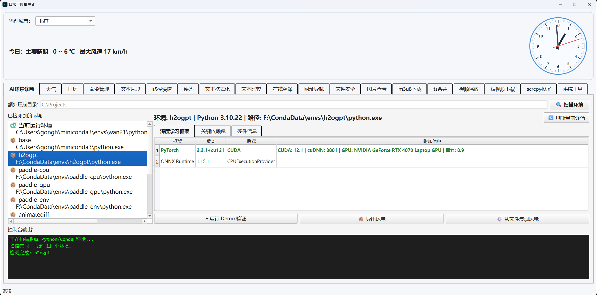

# 🧰 GeekStation

> **一个面向开发者、技术爱好者与个人极客的全本地化、高度集成的桌面生产力工作台。**
> 基于 Python 3 与 PySide6 (Qt 6) 构建，将高频系统操作、开发辅助、网络诊断与多媒体处理统一整合至单一界面。


---

## 📖 项目意义与价值

在日常开发与系统运维中，开发者往往需要频繁切换终端、浏览器、系统设置面板、文件管理器与各类零散脚本。这种“上下文切换”会显著打断深度工作流。

**GeekStation** 旨在解决这一痛点，其核心价值在于：
1. **收敛操作入口**：将天气、日历、便签、命令管理、环境诊断、远程投屏、音视频处理等 15+ 项功能聚合到一个符合人体工学的图形界面中，降低操作心智负担。
2. **本地数据主权**：所有用户配置、便签、播放列表与密钥信息均以明文 JSON 形式保存在本地 `data/` 目录，不经过任何第三方云端服务，充分保障隐私与数据安全。
3. **面向开发场景的深度定制**：内置多语言代码对比（智能剥离注释）、Anaconda/Pip 深度学习环境探测与导出、ADB/scrcpy 无线投屏控制、M3U8 下载与 TS 分片合并等硬核能力，精准贴合算法与后台开发者的实际调试需求。

---

## 🚀 环境配置

### 1. 基础运行环境
- **操作系统**：Windows 10 / 11 (64-bit)
- **Python 版本**：`3.10` - `3.12`（建议使用虚拟环境或 Anaconda  环境）

### 2. 依赖安装
克隆仓库后，在项目根目录执行：

```bash
# 安装 Python 依赖
pip install -r requirements.txt
```

`requirements.txt` 的核心依赖包括：
```text
PySide6>=6.6
requests>=2.31
lunar-python>=1.3.12
pycaw>=20240210
comtypes>=1.2.0
translators>=4.5.6
cryptography>=41.0.0
aiohttp>=3.9.0
pycryptodome>=3.19.0
```

### 3. 外部二进制工具（按需配置）
本项目部分模块依赖系统级或第三方二进制组件，请在首次使用对应功能前进行配置：

| 工具名称 | 用途 | 获取方式与配置 |
| :--- | :--- | :--- |
| **FFmpeg** | 视频无损合并（`ts合并` 模块）、部分多媒体处理 | 下载 Windows 静态构建版，将 `ffmpeg.exe` 所在目录加入系统 `PATH` |
| **ADB & scrcpy** | Android 设备有线/无线投屏与调试 | 下载 scrcpy 官方发布包，在 `scrcpy投屏` 标签页中指定 `scrcpy.exe` 与 `adb.exe` 路径 |
| **libmpv (mpv-2.dll)** | `视频播放` 模块的 libmpv 备用引擎 | 下载官方 `mpv-dev` 构建包，将 `libmpv-2.dll` 放入项目根目录 |

---

## 🏗️ 整体框架描述

项目采用**三层分离架构**，保障各模块的解耦与可维护性：

```text
├── main.py                     # 程序入口，主题初始化与主窗口启动
├── app/
│   ├── main_window.py          # 主窗口，承载 15+ 个功能 Tab 与全局状态管理
│   ├── services/               # 服务层（纯逻辑，无 UI 依赖）
│   │   ├── weather_service.py  # 天气 API 请求与 WMO 编码解析
│   │   ├── env_detect_service.py # 深度学习环境探测与硬件识别
│   │   ├── m3u8_service.py     # HLS 解析、AES 解密与异步下载
│   │   └── ...
│   ├── workers/                # 后台线程层（QThreadPool / QRunnable）
│   ├── players/                # 播放引擎适配器（QtMultimedia / libmpv 双实现）
│   ├── tabs/                   # UI 层（各功能面板）
│   ├── widgets/                # 自定义控件（圆形时钟、天气图标、视频渲染表面等）
│   └── utils/                  # 通用工具（安全的 JSON 读写、主题管理）
└── data/                       # 本地持久化数据（首次运行自动生成）
```

**设计原则**：
- **UI 与逻辑解耦**：`services/` 层不导入任何 PySide6 控件，便于独立进行单元测试。
- **异步防卡顿**：耗时的网络请求、文件扫描与环境探测均通过 `Worker` + `Signal` 在后台执行，确保主线程流畅。
- **多引擎适配**：视频播放模块抽象了 `BasePlayerAdapter` 接口，支持在 QtMultimedia 与 libmpv 之间热切换。

---

## 🧩 功能模块描述

| 模块名称 | 核心能力与说明 |
| :--- | :--- |
| 🌤️ **天气** | 基于 Open-Meteo 的 15 日天气预报，支持城市切换、温度双折线图与自绘天气图标。 |
| 📅 **日历** | 内置农历、节气、生肖与法定节假日（调休）标注，支持月份切换与详情展示。 |
| ⌨️ **命令管理** | 支持 CMD / PowerShell / Anaconda  命令的添加、编辑与多选删除；双击即在 Windows Terminal 新标签页中执行。 |
| 📝 **文本片段** | 常用文本的本地库，支持单击复制、多选删除与全文悬停预览。 |
| 📂 **路径快捷** | 常用文件与文件夹的快速跳转入口，双击即在资源管理器中定位。 |
| 🗒️ **便签** | 基于日期的三列看板（待办 / 进行中 / 已完成），支持拖拽状态流转与历史记录查询。 |
| 🔤 **文本格式化** | 多行命令拼接、去空格、去指定字符串，以及 CMD / PowerShell / Linux 续行符转换。 |
| ⚖️ **文本比较** | 支持纯文本与多语言代码对比，可智能剥离注释后再进行差异高亮展示。 |
| 🌐 **在线翻译** | 基于 `Translators` 库，聚合必应 / 谷歌 / 百度等免费翻译接口（详见下方合规提示）。 |
| 🔗 **网址导航** | 分类管理开发者高频网站，支持分类增删、排序与自定义浏览器打开。 |
| 🔐 **文件安全** | 基于 AES-GCM 的文件加密/解密，以及基于 Windows 属性 API 的文件/文件夹隐藏与恢复。 |
| 🖼️ **图片查看** | 高性能缩略图网格查看，支持全屏预览、缩放与滑动翻页。 |
| 📥 **M3U8 下载** | 支持 HLS 流解析、AES-128 解密、多线程下载与 FFmpeg 自动合并。 |
| 🧩 **TS 合并** | 本地 M3U8/TS 分片检测修复与 FFmpeg 无损封装。 |
| 🎬 **视频播放** | 本地与网络流播放，支持播放列表、拖拽导入、全屏、快捷键与双引擎（QtMultimedia / libmpv）切换。 |
| 📱 **scrcpy 投屏** | 集成 ADB 无线/有线连接与 scrcpy 启动，附带 Android 硬件与 AI 算力检测建议。 |
| 🐍 **AI 环境诊断** | 自动扫描系统中的 Python/Anaconda /Venv 环境，探测 PyTorch/TensorFlow 等框架的 GPU 支持情况，支持导出环境配置。 |
| ⚙️ **系统工具** | 快捷控制面板（音量、蓝牙、Wi-Fi、电源）、系统管理面板与开发者调试工具集（netstat / tracert / 自启项 / 虚拟键盘等）。 |

---

## 🏃 运行步骤

1. **启动程序**
   在项目根目录执行：
   ```bash
   python main.py
   ```
2. **首次使用配置**
   - 程序会在根目录自动创建 `data/` 文件夹用于存放配置。
   - 天气模块会在后台自动拉取默认城市数据。
   - 涉及外部二进制的模块（如 `ts合并`），请在界面中手动指定 `ffmpeg.exe` 路径。
3. **快捷键**
   - `Esc`：触发退出确认对话框。
   - `F11`：在视频播放器中切换全屏。
   - `Space`：视频播放器中播放 / 暂停。
   - `Ctrl+L`：视频播放器中隐藏 / 显示左侧列表。

---

## ⚠️ 注意事项与合规风险提示

> **【重要声明】**
> 本项目为开源技术学习与研究项目，**不构成任何专业法律、合规或安全建议**。软件按“原样”（AS IS）提供，作者不对因使用本软件产生的任何直接或间接后果承担责任。在使用前，请务必阅读并理解以下合规边界。

### 1. 网络代理功能（`视频播放` 模块）
- 本软件**不提供、不内置、不分发**任何代理服务器节点、订阅链接或访问凭据。
- 代理配置界面仅为技术实现层（基于 `QNetworkProxy` 与 FFmpeg 环境变量）预留的通用网络接口，**默认关闭**，且不提供任何默认地址。
- **合规警告**：在许多国家和地区（包括中国大陆），未经电信主管部门批准，擅自建立或使用非法定信道进行国际联网属于违法行为。请务必在使用前了解并遵守所在地的法律法规。开发者不对任何因配置或使用代理功能而产生的合规风险负责。

### 2. 流媒体与短视频下载功能（`M3U8 下载`、`短视频下载`、`ts合并` 模块）
- 本软件**不托管、不传播、不存储**任何受版权保护的媒体内容。所有下载与合并行为均发生在用户本地设备上，由用户自行发起。
- 本软件**不鼓励、不支持**用于绕过任何平台的付费墙、版权保护措施（DRM）或侵犯第三方知识产权。
- **使用边界**：请仅下载您**拥有合法访问权限**或**已获得明确授权**的内容。对于抖音、快手、Bilibili 等平台，自动化抓取行为可能违反其服务条款（ToS），请在使用前确认您已获得平台的许可或相关内容的授权。**任何因违反平台服务条款或版权法而产生的纠纷与责任，由用户自行承担。**

### 3. 在线翻译功能（`在线翻译` 模块）
- 本项目集成了开源库 `Translators` 作为翻译后端。该库封装了多家翻译平台的网页接口，属于**非官方（unofficial）API 调用**，并非各翻译平台官方提供的正式服务。
- 该功能可能存在请求频率限制、接口失效或服务不稳定等风险，**不建议用于任何关键业务或生产环境**。频繁调用可能触发平台风控，由此导致的网络限制或服务中断由使用者自行承担。

### 4. 文件安全与加密功能（`文件安全` 模块）
- 本模块提供的加密与隐藏能力属于技术中性工具，请确保您仅对**自己拥有合法所有权的文件**进行加密、隐藏或恢复操作。
- 请妥善保管加密密钥或密码。**软件不提供任何密码找回机制，一旦遗失密码，加密文件将永久无法解密。**

### 5. 第三方开源组件的许可与合规责任
- 本项目依赖 PySide6（LGPLv3）、FFmpeg（GPL/LGPL）、libmpv（LGPL）等第三方开源组件。用户在**再分发**本软件（包括打包后的二进制可执行文件）时，**必须自行确保**符合上述各组件所要求的许可证条款（包括但不限于提供相应的源代码、保留版权声明、遵守动态/静态链接的合规要求等）。
- 对于因用户自行再分发或商业使用而引发的任何许可协议纠纷，本项目作者不承担任何连带责任。

---

## 📚 参考资料

1. **MIT License 标准免责条款**  
   本项目采用 MIT License 开源。其标准免责声明原文为：  
   > THE SOFTWARE IS PROVIDED "AS IS", WITHOUT WARRANTY OF ANY KIND, EXPRESS OR IMPLIED, INCLUDING BUT NOT LIMITED TO THE WARRANTIES OF MERCHANTABILITY, FITNESS FOR A PARTICULAR PURPOSE AND NONINFRINGEMENT. IN NO EVENT SHALL THE AUTHORS OR COPYRIGHT HOLDERS BE LIABLE FOR ANY CLAIM, DAMAGES OR OTHER LIABILITY, WHETHER IN AN ACTION OF CONTRACT, TORT OR OTHERWISE, ARISING FROM, OUT OF OR IN CONNECTION WITH THE SOFTWARE OR THE USE OR OTHER DEALINGS IN THE SOFTWARE.

2. **开源网络工具合规实践参考**  
   多家开源网络代理与媒体工具在其文档中明确声明：工具本身不提供任何网络节点或受版权保护的内容，使用者需自行确认其行为是否符合当地法律与服务条款。

3. **非官方翻译接口免责示例**  
   类似 `googletrans` 等非官方封装库普遍声明其与官方机构无关联，仅依赖公开 Web 接口，不对接口变更或服务稳定性提供保证。

4. **技术规范参考**  
   - [PySide6 官方文档](https://doc.qt.io/qtforpython-6/)
   - [FFmpeg 官方协议许可说明](https://ffmpeg.org/legal.html)
   - [mpv 官方文档与构建获取](https://mpv.io/installation/)
   - [MIT License 全文](https://opensource.org/licenses/MIT)

---

## 📄 许可协议

本项目基于 [MIT License](LICENSE) 开源。  
**再次强调：使用本软件即代表您已阅读并同意上述所有注意事项与风险提示，并自愿承担因使用本软件而产生的一切后果。**